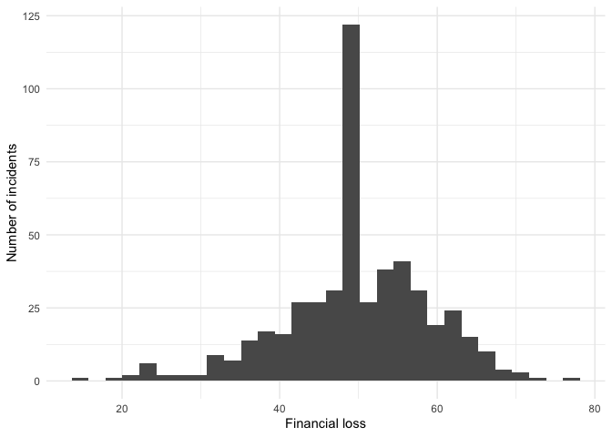
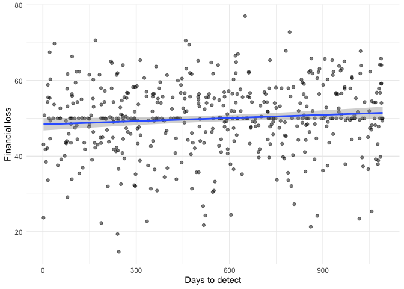
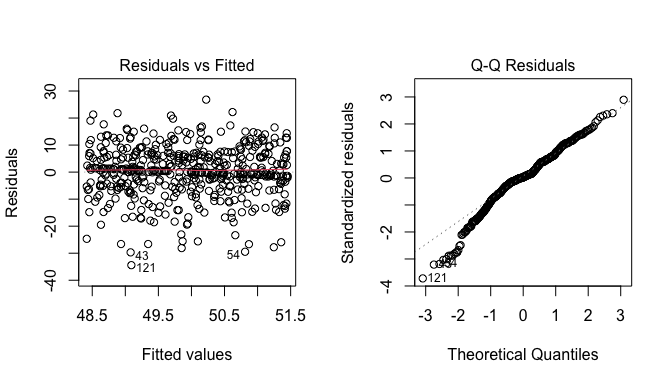
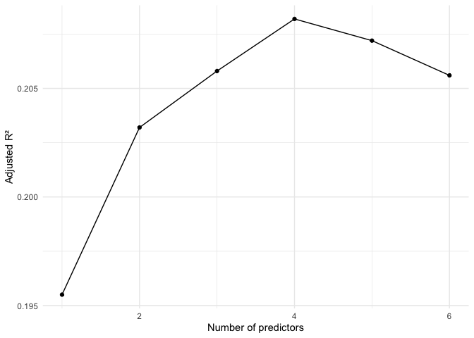

# What Drives the Cost of a Data Breach? A Regression Analysis
Abdulaziz BinAbid

## Overview

This analysis comes from my work in SRA 365 (Statistics for Security and
Risk Analysis) at Penn State. The data describe 500 simulated data
breach incidents: how many records and people were affected, the share
of sensitive data, how long the breach took to detect, how long its
impact lasted, how much was spent on security controls, and the
resulting financial loss.

I work through six questions, moving from simple to more complex models:

1.  How are the key variables distributed, and is the data clean?
2.  Does detection time predict financial loss on its own?
3.  Do the assumptions of linear regression hold for that model?
4.  Which combination of factors best explains financial loss?
5.  Can the share of sensitive data predict whether a breach is detected
    quickly?
6.  Are the categorical versions of these factors associated with each
    other?

A final section checks whether my conclusions hold up after removing
rows that look like placeholder data.

``` r
library(ggplot2)
library(car)       # durbinWatsonTest, vif
library(lmtest)    # bptest
library(leaps)     # regsubsets
library(gmodels)   # CrossTable
library(knitr)

theme_set(theme_minimal())

fmt   <- function(x, d = 3) formatC(x, format = "f", digits = d)
fmt_p <- function(p) if (p < 0.001) "< .001" else paste("=", fmt(p, 3))

breach   <- read.delim("data/breaches.dat", header = TRUE)
cat_data <- read.csv("data/breaches_categorical.csv", header = TRUE)

predictors <- c("num_records", "dys_detect", "per_sensitive",
                "cost_controls", "dys_impact", "num_people")
```

## 1. Distributions and data quality

``` r
vars <- c("fin_loss", predictors)
desc <- data.frame(
  mean = sapply(breach[vars], mean),
  sd   = sapply(breach[vars], sd),
  min  = sapply(breach[vars], min),
  max  = sapply(breach[vars], max)
)
kable(round(desc, 2))
```

|               |   mean |     sd |   min |     max |
|:--------------|-------:|-------:|------:|--------:|
| fin_loss      |  49.94 |   9.31 | 14.67 |   77.03 |
| num_records   |  49.36 |   9.34 | 19.67 |   77.63 |
| dys_detect    | 547.58 | 317.69 |  2.00 | 1092.00 |
| per_sensitive |  48.51 |  27.79 |  0.00 |  100.00 |
| cost_controls |  49.73 |   6.65 | 23.56 |   74.31 |
| dys_impact    | 685.25 | 419.95 | 48.00 | 1806.00 |
| num_people    |  49.64 |   9.33 | 12.96 |   72.83 |

``` r
ggplot(breach, aes(fin_loss)) +
  geom_histogram(bins = 30) +
  labs(x = "Financial loss", y = "Number of incidents")
```



``` r
breach$z_fin_loss <- as.numeric(scale(breach$fin_loss))
extreme <- breach[abs(breach$z_fin_loss) > 3, c("event_ID", "fin_loss", "z_fin_loss")]
kable(extreme, digits = 2, row.names = FALSE)
```

| event_ID | fin_loss | z_fin_loss |
|---------:|---------:|-----------:|
|       27 |    21.75 |      -3.03 |
|       43 |    19.39 |      -3.28 |
|       54 |    21.34 |      -3.07 |
|      121 |    14.67 |      -3.79 |

Several variables (financial loss, records, people) appear to be
rescaled so they average about 50, so I describe effects in those scaled
points rather than in dollars. Detection and impact are measured in
days, and sensitive data is a percentage.

Financial loss is roughly bell-shaped, with a slightly longer left tail.
4 incidents sit more than three standard deviations below the mean, with
losses between 14.7 and 21.8. Nothing suggests these are entry errors,
so I keep them, but they come up again in the normality check. Detection
time and the share of sensitive data are spread fairly evenly across
their ranges, with no extreme values.

### Placeholder values

``` r
breach$placeholder   <- breach$num_people == 50 & breach$num_records == 50
cat_data$placeholder <- cat_data$num_people == 50 & cat_data$num_records == 50

n_placeholder <- sum(breach$placeholder)
n_loss50      <- sum(breach$placeholder & breach$fin_loss == 50)
n_cost50      <- sum(breach$cost_controls == 50)
c(placeholder_rows = n_placeholder, of_which_loss_is_50 = n_loss50, cost_controls_exactly_50 = n_cost50)
```

            placeholder_rows      of_which_loss_is_50 cost_controls_exactly_50 
                          80                       79                      217 

While exploring the data, I noticed that 80 incidents have the number of
people and the number of records both at exactly 50, and 79 of them also
have a financial loss of exactly 50. Since 50 is the center of the
scale, this pattern looks like missing values filled in with a default
rather than real observations. Cost of controls has the same problem on
a larger scale: 217 incidents are exactly 50. I keep these rows in the
main analysis to match the course assignments, then test in Section 7
whether removing them changes my conclusions.

## 2. Simple regression: detection time and financial loss

``` r
m_simple <- lm(fin_loss ~ dys_detect, data = breach)
summary(m_simple)
```


    Call:
    lm(formula = fin_loss ~ dys_detect, data = breach)

    Residuals:
        Min      1Q  Median      3Q     Max 
    -34.421  -4.594   0.259   5.935  26.807 

    Coefficients:
                 Estimate Std. Error t value Pr(>|t|)    
    (Intercept) 48.411456   0.826923  58.544   <2e-16 ***
    dys_detect   0.002787   0.001307   2.133   0.0334 *  
    ---
    Signif. codes:  0 '***' 0.001 '**' 0.01 '*' 0.05 '.' 0.1 ' ' 1

    Residual standard error: 9.272 on 498 degrees of freedom
    Multiple R-squared:  0.009052,  Adjusted R-squared:  0.007062 
    F-statistic: 4.549 on 1 and 498 DF,  p-value: 0.03342

``` r
ggplot(breach, aes(dys_detect, fin_loss)) +
  geom_point(alpha = 0.5) +
  geom_smooth(method = "lm", se = TRUE) +
  labs(x = "Days to detect", y = "Financial loss")
```



``` r
new_case <- data.frame(dys_detect = 365)
conf_int <- predict(m_simple, new_case, interval = "confidence", level = 0.85)
pred_int <- predict(m_simple, new_case, interval = "prediction", level = 0.85)
rbind(confidence = conf_int, prediction = pred_int)
```

           fit      lwr      upr
    1 49.42862 48.73892 50.11833
    1 49.42862 36.04272 62.81453

``` r
slope <- coef(m_simple)["dys_detect"]
r2    <- summary(m_simple)$r.squared
p_det <- summary(m_simple)$coefficients["dys_detect", "Pr(>|t|)"]
```

Detection time is a statistically significant predictor of financial
loss (p = 0.033), but the effect is small. Each additional 100 days
before detection adds about 0.28 points of loss, and detection time
explains only 0.9% of the variation in loss. With 500 incidents, even a
weak relationship reaches significance, so I read this result as “real
but minor” rather than “important.”

For a breach that goes undetected for a full year, the model predicts a
loss of 49.4. The 85% confidence interval (48.7 to 50.1) estimates the
*average* loss for all breaches detected after 365 days, so it is
narrow. The 85% prediction interval (36.0 to 62.8) covers a *single*
breach, so it adds the scatter between individual incidents on top of
that and comes out far wider. In practice, knowing detection time alone
tells me very little about what any one breach will cost.

## 3. Checking regression assumptions

I check the assumptions of the model from Section 2.

``` r
set.seed(365)                          # durbinWatsonTest uses a bootstrap p-value
dw <- durbinWatsonTest(m_simple)       # independence of errors
bp <- bptest(m_simple)                 # equal variance (Breusch-Pagan)
sw <- shapiro.test(residuals(m_simple))  # normality of residuals
dw; bp; sw
```

     lag Autocorrelation D-W Statistic p-value
       1     0.009047076      1.977986   0.776
     Alternative hypothesis: rho != 0


        studentized Breusch-Pagan test

    data:  m_simple
    BP = 0.16788, df = 1, p-value = 0.682


        Shapiro-Wilk normality test

    data:  residuals(m_simple)
    W = 0.97397, p-value = 9.154e-08

``` r
par(mfrow = c(1, 2))
plot(m_simple, which = 1)  # residuals vs fitted
plot(m_simple, which = 2)  # normal Q-Q
```



``` r
par(mfrow = c(1, 1))
```

``` r
std_r <- rstandard(m_simple)
beyond_2 <- mean(abs(std_r) > 2)
beyond_3 <- sum(abs(std_r) > 3)
c(share_beyond_2 = round(beyond_2, 3), count_beyond_3 = beyond_3)
```

    share_beyond_2 count_beyond_3 
             0.052          5.000 

- **Independence:** the Durbin-Watson statistic is 1.98, close to the
  ideal value of 2 (p = 0.776). There is no evidence that errors are
  correlated across incidents.
- **Equal variance:** the Breusch-Pagan test finds no heteroscedasticity
  (p = 0.682), and the residuals in the residuals vs fitted plot form an
  even band without a funnel shape.
- **Normality:** the Shapiro-Wilk test rejects normality (W = 0.974, p
  \< .001). The Q-Q plot shows this comes from the lower tail, which
  matches the handful of unusually low losses from Section 1. With 500
  observations, Shapiro-Wilk flags even small departures, and the
  coefficient tests are fairly robust at this sample size, so I treat
  this as a caution rather than a reason to throw out the model.
- **Standardized residuals:** 5.2% fall beyond ±2, close to the 5%
  expected in a well-behaved model. 5 fall beyond ±3, more than the one
  or two I would expect by chance. These are mostly the same extreme
  low-loss incidents.

Overall, the model is usable, with the main concern being a heavier
lower tail than a normal distribution would predict.

## 4. Multiple regression and model selection

### Best subsets

``` r
bs <- regsubsets(reformulate(predictors, "fin_loss"), data = breach,
                 nbest = 1, nvmax = length(predictors))
bs_sum <- summary(bs)

bs_table <- data.frame(
  size   = seq_along(bs_sum$adjr2),
  adj_r2 = round(bs_sum$adjr2, 4),
  vars   = apply(bs_sum$which[, -1, drop = FALSE], 1,
                 function(r) paste(names(r)[r], collapse = " + "))
)
kable(bs_table, col.names = c("Predictors", "Adjusted R²", "Best model"))
```

| Predictors | Adjusted R² | Best model |
|---:|---:|:---|
| 1 | 0.1955 | num_records |
| 2 | 0.2032 | num_records + dys_detect |
| 3 | 0.2058 | num_records + dys_detect + per_sensitive |
| 4 | 0.2082 | num_records + dys_detect + per_sensitive + cost_controls |
| 5 | 0.2072 | num_records + dys_detect + per_sensitive + cost_controls + dys_impact |
| 6 | 0.2056 | num_records + dys_detect + per_sensitive + cost_controls + dys_impact + num_people |

``` r
ggplot(bs_table, aes(size, adj_r2)) +
  geom_line() + geom_point() +
  labs(x = "Number of predictors", y = "Adjusted R²")
```



### Hierarchical models

Next, I add the predictors one at a time in the order best subsets
selected them, and test whether each addition significantly improves the
fit.

``` r
models <- lapply(seq_along(predictors), function(k)
  lm(reformulate(predictors[1:k], "fin_loss"), data = breach))

comparison <- data.frame(
  model  = seq_along(models),
  added  = predictors,
  adj_r2 = sapply(models, function(m) round(summary(m)$adj.r.squared, 4)),
  AIC    = sapply(models, function(m) round(AIC(m), 1))
)
kable(comparison, col.names = c("Model", "Predictor added", "Adjusted R²", "AIC"))
```

| Model | Predictor added | Adjusted R² |    AIC |
|------:|:----------------|------------:|-------:|
|     1 | num_records     |      0.1955 | 3544.7 |
|     2 | dys_detect      |      0.2032 | 3540.9 |
|     3 | per_sensitive   |      0.2058 | 3540.3 |
|     4 | cost_controls   |      0.2082 | 3539.7 |
|     5 | dys_impact      |      0.2072 | 3541.3 |
|     6 | num_people      |      0.2056 | 3543.3 |

``` r
aov_tab <- do.call(anova, models)   # F-test for each added predictor
aov_tab
```

    Analysis of Variance Table

    Model 1: fin_loss ~ num_records
    Model 2: fin_loss ~ num_records + dys_detect
    Model 3: fin_loss ~ num_records + dys_detect + per_sensitive
    Model 4: fin_loss ~ num_records + dys_detect + per_sensitive + cost_controls
    Model 5: fin_loss ~ num_records + dys_detect + per_sensitive + cost_controls + 
        dys_impact
    Model 6: fin_loss ~ num_records + dys_detect + per_sensitive + cost_controls + 
        dys_impact + num_people
      Res.Df   RSS Df Sum of Sq      F Pr(>F)  
    1    498 34690                             
    2    497 34289  1    400.36 5.8208 0.0162 *
    3    496 34108  1    181.38 2.6371 0.1050  
    4    495 33936  1    171.92 2.4996 0.1145  
    5    494 33909  1     27.08 0.3938 0.5306  
    6    493 33909  1      0.08 0.0011 0.9735  
    ---
    Signif. codes:  0 '***' 0.001 '**' 0.01 '*' 0.05 '.' 0.1 ' ' 1

``` r
f_p <- aov_tab$`Pr(>F)`
```

### Multicollinearity

``` r
full <- models[[length(models)]]
vif_full <- vif(full)
data.frame(VIF = round(vif_full, 2), tolerance = round(1 / vif_full, 3))
```

                   VIF tolerance
    num_records   6.69     0.150
    dys_detect    1.01     0.989
    per_sensitive 1.16     0.865
    cost_controls 1.14     0.879
    dys_impact    1.13     0.884
    num_people    6.45     0.155

``` r
round(cor(breach[, predictors]), 2)
```

                  num_records dys_detect per_sensitive cost_controls dys_impact
    num_records          1.00       0.00          0.07          0.31       0.00
    dys_detect           0.00       1.00          0.04          0.07       0.01
    per_sensitive        0.07       0.04          1.00         -0.10       0.33
    cost_controls        0.31       0.07         -0.10          1.00      -0.03
    dys_impact           0.00       0.01          0.33         -0.03       1.00
    num_people           0.92      -0.03          0.05          0.26       0.02
                  num_people
    num_records         0.92
    dys_detect         -0.03
    per_sensitive       0.05
    cost_controls       0.26
    dys_impact          0.02
    num_people          1.00

``` r
m_final <- models[[2]]   # num_records + dys_detect
summary(m_final)
```


    Call:
    lm(formula = reformulate(predictors[1:k], "fin_loss"), data = breach)

    Residuals:
        Min      1Q  Median      3Q     Max 
    -33.827  -4.417   0.090   5.158  24.497 

    Coefficients:
                Estimate Std. Error t value Pr(>|t|)    
    (Intercept) 26.56077    2.10066  12.644   <2e-16 ***
    num_records  0.44231    0.03979  11.116   <2e-16 ***
    dys_detect   0.00282    0.00117   2.409   0.0164 *  
    ---
    Signif. codes:  0 '***' 0.001 '**' 0.01 '*' 0.05 '.' 0.1 ' ' 1

    Residual standard error: 8.306 on 497 degrees of freedom
    Multiple R-squared:  0.2064,    Adjusted R-squared:  0.2032 
    F-statistic: 64.62 on 2 and 497 DF,  p-value: < 2.2e-16

``` r
vif(m_final)
```

    num_records  dys_detect 
       1.000006    1.000006 

Best subsets and the hierarchical models agree on the order of
importance. The number of records affected is by far the strongest
predictor: on its own, it explains about 20% of the variation in
financial loss, many times more than detection time did in Section 2.
Adjusted R² peaks at four predictors (0.208) and then falls, because the
last two predictors add almost nothing.

The F-tests give a stricter answer. After records, only detection time
adds significant explanatory power (p = 0.016). The share of sensitive
data (p = 0.105) and cost of controls (p = 0.115) do not reach
significance, and impact duration and number of people contribute
nothing. AIC is lowest at four predictors, but only about 1.2 points
below the two-predictor model, which is too small a difference to
matter. I would choose the **two-predictor model (records + detection
time)**. It is simpler, every term in it is significant, and it gives up
only about half a percentage point of adjusted R² compared to the best
model.

Multicollinearity explains why the number of people adds nothing. It
correlates with the number of records at r = 0.92, which pushes both
VIFs above 6 in the full model (tolerance around 0.15). That is below
the common cutoff of 10, but it means the two variables carry mostly the
same information: once I know how many records leaked, the number of
people affected is largely redundant. The chosen model avoids the
problem, and its VIFs are close to 1.

## 5. Logistic regression: predicting fast detection

``` r
cat_data$dys_detect_v2 <- factor(cat_data$dys_detect_v2)

# Set the reference level BEFORE fitting; glm models the probability of the other level
cat_data$dys_detect_v2 <- relevel(cat_data$dys_detect_v2, ref = "Slow")
lv <- levels(cat_data$dys_detect_v2)
table(cat_data$dys_detect_v2)
```


    Slow Fast 
     445   55 

``` r
m_logit <- glm(dys_detect_v2 ~ per_sensitive, data = cat_data, family = binomial)
summary(m_logit)
```


    Call:
    glm(formula = dys_detect_v2 ~ per_sensitive, family = binomial, 
        data = cat_data)

    Coefficients:
                    Estimate Std. Error z value Pr(>|z|)    
    (Intercept)   -2.0597808  0.2862039  -7.197 6.16e-13 ***
    per_sensitive -0.0006407  0.0051522  -0.124    0.901    
    ---
    Signif. codes:  0 '***' 0.001 '**' 0.01 '*' 0.05 '.' 0.1 ' ' 1

    (Dispersion parameter for binomial family taken to be 1)

        Null deviance: 346.52  on 499  degrees of freedom
    Residual deviance: 346.50  on 498  degrees of freedom
    AIC: 350.5

    Number of Fisher Scoring iterations: 4

``` r
or_table <- exp(cbind(odds_ratio = coef(m_logit), confint.default(m_logit)))
round(or_table, 3)
```

                  odds_ratio 2.5 % 97.5 %
    (Intercept)        0.127 0.073  0.223
    per_sensitive      0.999 0.989  1.010

``` r
p_logit <- summary(m_logit)$coefficients["per_sensitive", "Pr(>|z|)"]
```

Predicted probabilities across the range of sensitive data, computed
from the model:

``` r
grid <- data.frame(per_sensitive = c(0, 25, 50, 75, 100))
grid$prob_fast <- round(predict(m_logit, grid, type = "response"), 3)
kable(grid, col.names = c("Percent sensitive", "P(fast detection)"))
```

| Percent sensitive | P(fast detection) |
|------------------:|------------------:|
|                 0 |             0.113 |
|                25 |             0.111 |
|                50 |             0.110 |
|                75 |             0.108 |
|               100 |             0.107 |

``` r
predicted <- factor(ifelse(fitted(m_logit) > 0.5, lv[2], lv[1]), levels = lv)
observed  <- model.frame(m_logit)$dys_detect_v2
conf_mat  <- table(observed, predicted)
conf_mat
```

            predicted
    observed Slow Fast
        Slow  445    0
        Fast   55    0

``` r
accuracy  <- sum(diag(conf_mat)) / sum(conf_mat)
n_fast    <- sum(observed == "Fast")
```

The model estimates the probability that a breach is detected **Fast**,
with Slow as the reference group. Only 55 of 500 breaches (11%) were
detected fast.

The share of sensitive data has no meaningful relationship with
detection speed. The odds ratio is 0.999 per percentage point (p =
0.901), so the predicted probability of fast detection stays around 11%
whether a breach involves none or all sensitive data.

The classification table shows a consequence worth pointing out. At a
0.5 cutoff, the model predicts every breach as slow, which gives an
accuracy of 89%. That sounds strong, but it is exactly what I would get
by always guessing “slow,” and the model identifies zero of the fast
detections. With imbalanced classes, accuracy is misleading. To evaluate
a model like this properly, I would look at sensitivity for the minority
class or adjust the cutoff instead.

## 6. Associations between categorical factors

``` r
pairs <- list(
  c("cost_controls_v2", "num_people_v2"),
  c("cost_controls_v2", "per_sensitive_v2"),
  c("dys_detect_v2",    "cost_controls_v2")
)

for (p in pairs) {
  cat("\n\n=====", p[1], "by", p[2], "=====\n")
  is_2x2 <- length(unique(cat_data[[p[1]]])) == 2 && length(unique(cat_data[[p[2]]])) == 2
  CrossTable(cat_data[[p[1]]], cat_data[[p[2]]],
             chisq = TRUE, fisher = is_2x2, expected = TRUE,
             sresid = TRUE, format = "SPSS")
}
```


    ===== cost_controls_v2 by num_people_v2 =====


       Cell Contents
    |-------------------------|
    |                   Count |
    |         Expected Values |
    | Chi-square contribution |
    |             Row Percent |
    |          Column Percent |
    |           Total Percent |
    |            Std Residual |
    |-------------------------|

    Total Observations in Table:  500 

                     | cat_data[[p[2]]] 
    cat_data[[p[1]]] | Between 30 to 60 million  |     Less than 30 million  |     More than 60 million  |                Row Total | 
    -----------------|--------------------------|--------------------------|--------------------------|--------------------------|
                High |                     101  |                       1  |                      26  |                     128  | 
                     |                 108.800  |                   2.816  |                  16.384  |                          | 
                     |                   0.559  |                   1.171  |                   5.644  |                          | 
                     |                  78.906% |                   0.781% |                  20.312% |                  25.600% | 
                     |                  23.765% |                   9.091% |                  40.625% |                          | 
                     |                  20.200% |                   0.200% |                   5.200% |                          | 
                     |                  -0.748  |                  -1.082  |                   2.376  |                          | 
    -----------------|--------------------------|--------------------------|--------------------------|--------------------------|
                 Low |                     324  |                      10  |                      38  |                     372  | 
                     |                 316.200  |                   8.184  |                  47.616  |                          | 
                     |                   0.192  |                   0.403  |                   1.942  |                          | 
                     |                  87.097% |                   2.688% |                  10.215% |                  74.400% | 
                     |                  76.235% |                  90.909% |                  59.375% |                          | 
                     |                  64.800% |                   2.000% |                   7.600% |                          | 
                     |                   0.439  |                   0.635  |                  -1.394  |                          | 
    -----------------|--------------------------|--------------------------|--------------------------|--------------------------|
        Column Total |                     425  |                      11  |                      64  |                     500  | 
                     |                  85.000% |                   2.200% |                  12.800% |                          | 
    -----------------|--------------------------|--------------------------|--------------------------|--------------------------|

     
    Statistics for All Table Factors


    Pearson's Chi-squared test 
    ------------------------------------------------------------
    Chi^2 =  9.911385     d.f. =  2     p =  0.007043201 


     
           Minimum expected frequency: 2.816 
    Cells with Expected Frequency < 5: 1 of 6 (16.66667%)


    ===== cost_controls_v2 by per_sensitive_v2 =====

       Cell Contents
    |-------------------------|
    |                   Count |
    |         Expected Values |
    | Chi-square contribution |
    |             Row Percent |
    |          Column Percent |
    |           Total Percent |
    |            Std Residual |
    |-------------------------|

    Total Observations in Table:  500 

                     | cat_data[[p[2]]] 
    cat_data[[p[1]]] |     High  |      Low  | Moderate  | Row Total | 
    -----------------|-----------|-----------|-----------|-----------|
                High |       38  |       54  |       36  |      128  | 
                     |   36.864  |   37.120  |   54.016  |           | 
                     |    0.035  |    7.676  |    6.009  |           | 
                     |   29.688% |   42.188% |   28.125% |   25.600% | 
                     |   26.389% |   37.241% |   17.062% |           | 
                     |    7.600% |   10.800% |    7.200% |           | 
                     |    0.187  |    2.771  |   -2.451  |           | 
    -----------------|-----------|-----------|-----------|-----------|
                 Low |      106  |       91  |      175  |      372  | 
                     |  107.136  |  107.880  |  156.984  |           | 
                     |    0.012  |    2.641  |    2.068  |           | 
                     |   28.495% |   24.462% |   47.043% |   74.400% | 
                     |   73.611% |   62.759% |   82.938% |           | 
                     |   21.200% |   18.200% |   35.000% |           | 
                     |   -0.110  |   -1.625  |    1.438  |           | 
    -----------------|-----------|-----------|-----------|-----------|
        Column Total |      144  |      145  |      211  |      500  | 
                     |   28.800% |   29.000% |   42.200% |           | 
    -----------------|-----------|-----------|-----------|-----------|

     
    Statistics for All Table Factors


    Pearson's Chi-squared test 
    ------------------------------------------------------------
    Chi^2 =  18.44077     d.f. =  2     p =  9.90006e-05 


     
           Minimum expected frequency: 36.864 


    ===== dys_detect_v2 by cost_controls_v2 =====

       Cell Contents
    |-------------------------|
    |                   Count |
    |         Expected Values |
    | Chi-square contribution |
    |             Row Percent |
    |          Column Percent |
    |           Total Percent |
    |            Std Residual |
    |-------------------------|

    Total Observations in Table:  500 

                     | cat_data[[p[2]]] 
    cat_data[[p[1]]] |     High  |      Low  | Row Total | 
    -----------------|-----------|-----------|-----------|
                Slow |      118  |      327  |      445  | 
                     |  113.920  |  331.080  |           | 
                     |    0.146  |    0.050  |           | 
                     |   26.517% |   73.483% |   89.000% | 
                     |   92.188% |   87.903% |           | 
                     |   23.600% |   65.400% |           | 
                     |    0.382  |   -0.224  |           | 
    -----------------|-----------|-----------|-----------|
                Fast |       10  |       45  |       55  | 
                     |   14.080  |   40.920  |           | 
                     |    1.182  |    0.407  |           | 
                     |   18.182% |   81.818% |   11.000% | 
                     |    7.812% |   12.097% |           | 
                     |    2.000% |    9.000% |           | 
                     |   -1.087  |    0.638  |           | 
    -----------------|-----------|-----------|-----------|
        Column Total |      128  |      372  |      500  | 
                     |   25.600% |   74.400% |           | 
    -----------------|-----------|-----------|-----------|

     
    Statistics for All Table Factors


    Pearson's Chi-squared test 
    ------------------------------------------------------------
    Chi^2 =  1.785479     d.f. =  1     p =  0.181478 

    Pearson's Chi-squared test with Yates' continuity correction 
    ------------------------------------------------------------
    Chi^2 =  1.374676     d.f. =  1     p =  0.24101 

     
    Fisher's Exact Test for Count Data
    ------------------------------------------------------------
    Sample estimate odds ratio:  1.622428 

    Alternative hypothesis: true odds ratio is not equal to 1
    p =  0.2507607 
    95% confidence interval:  0.7745012 3.729132 

    Alternative hypothesis: true odds ratio is less than 1
    p =  0.9373052 
    95% confidence interval:  0 3.263765 

    Alternative hypothesis: true odds ratio is greater than 1
    p =  0.1185797 
    95% confidence interval:  0.8580817 Inf 


     
           Minimum expected frequency: 14.08 

``` r
chi_p <- function(df, p) suppressWarnings(
  chisq.test(table(df[[p[1]]], df[[p[2]]]), correct = FALSE))

chi_all <- lapply(pairs, function(p) chi_p(cat_data, p))
chi_exc <- lapply(pairs, function(p) chi_p(cat_data[!cat_data$placeholder, ], p))

# Fisher's exact test for the table with a small expected count
set.seed(365)
fisher_people <- fisher.test(table(cat_data$cost_controls_v2, cat_data$num_people_v2),
                             simulate.p.value = TRUE, B = 1e5)

kable(data.frame(
  pair                 = sapply(pairs, paste, collapse = " × "),
  chi_sq               = sapply(chi_all, function(x) round(x$statistic, 2)),
  df                   = sapply(chi_all, function(x) x$parameter),
  p_all_rows           = sapply(chi_all, function(x) round(x$p.value, 4)),
  p_without_placeholders = sapply(chi_exc, function(x) round(x$p.value, 4))
), row.names = FALSE)
```

| pair | chi_sq | df | p_all_rows | p_without_placeholders |
|:---|---:|---:|---:|---:|
| cost_controls_v2 × num_people_v2 | 9.91 | 2 | 0.0070 | 0.0533 |
| cost_controls_v2 × per_sensitive_v2 | 18.44 | 2 | 0.0001 | 0.0237 |
| dys_detect_v2 × cost_controls_v2 | 1.79 | 1 | 0.1815 | 0.2153 |

On the full data, two of the three pairs show significant associations:

- **Cost of controls × people affected:** χ²(2) = 9.91, p = 0.007. One
  expected count is below 5 because only 11 incidents affected fewer
  than 30 million people, so I also ran Fisher’s exact test, which
  agrees (p = 0.008). The association is driven by high-control
  incidents being overrepresented among breaches affecting more than 60
  million people (standardized residual above 1.96).
- **Cost of controls × share of sensitive data:** χ²(2) = 18.44, p \<
  .001. High-control incidents are overrepresented among breaches with
  low sensitive data and underrepresented among those with moderate
  sensitive data.
- **Detection speed × cost of controls:** no significant association (p
  = 0.181).

These results need a caveat. The categorical version of cost of controls
codes exactly 50 as “Low,” and 217 incidents sit at exactly 50. Most of
the placeholder rows from Section 1 also fall in the “Moderate”
sensitive data group. That combination inflates the Low-control,
Moderate-sensitivity cell, which pushes down the share of high-control
incidents in the Moderate group, one of the cells driving the second
association. When I drop the 80 placeholder rows, the sensitive data
association weakens considerably (p = 0.024), and the people-affected
association is no longer significant at .05 (p = 0.053). I would not
draw conclusions from either association without cleaner data.

## 7. Sensitivity check: removing placeholder rows

``` r
m_clean <- lm(fin_loss ~ num_records + dys_detect, data = breach[!breach$placeholder, ])

compare_fit <- function(m) c(
  n              = nobs(m),
  b_num_records  = coef(m)[["num_records"]],
  b_dys_detect   = coef(m)[["dys_detect"]],
  p_dys_detect   = summary(m)$coefficients["dys_detect", "Pr(>|t|)"],
  r_squared      = summary(m)$r.squared
)
kable(round(rbind(all_rows = compare_fit(m_final), without_placeholders = compare_fit(m_clean)), 4))
```

|                      |   n | b_num_records | b_dys_detect | p_dys_detect | r_squared |
|:---------------------|----:|--------------:|-------------:|-------------:|----------:|
| all_rows             | 500 |        0.4423 |       0.0028 |       0.0164 |    0.2064 |
| without_placeholders | 420 |        0.4428 |       0.0034 |       0.0160 |    0.2086 |

Unlike the categorical results, the regression findings hold up. Without
the placeholder rows, the coefficient for records and the significance
of detection time barely change, and R² stays at about 21%. The
placeholder rows sit at the center of the scale, so they add little to a
linear fit, but they matter much more once continuous values are cut
into categories.

## Conclusions

- **The scale of the breach drives its cost.** The number of records
  affected is by far the strongest predictor of financial loss.
  Detection time adds a small but reliable effect, and the share of
  sensitive data, cost of controls, impact duration and number of people
  add little or nothing once records are known.
- **Detection time matters, but modestly.** On its own, it explains
  about 1% of the variation in loss. Faster detection is associated with
  lower loss, but it is far from the whole story.
- **Sensitive data does not predict detection speed.** The logistic
  model performed no better than always guessing “slow,” which also
  illustrates why accuracy alone is a poor metric for imbalanced
  outcomes.
- **Data quality changes some conclusions.** About 16% of incidents look
  like placeholder rows. The regression results survive removing them,
  but the categorical associations mostly do not.

**Limitations:** the data are simulated and appear to be rescaled, so
effect sizes are in scaled units rather than dollars. The residuals have
a heavier lower tail than a normal distribution. All of these
relationships are correlational and do not show cause and effect.
